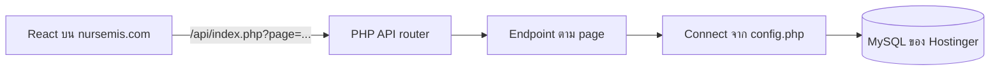

# สอนแก้ PHP API จาก Docker ให้ทำงานบน Hostinger

เอกสารนี้ใช้โค้ดจริงของ Nurse MIS ที่แก้แล้วเป็นกรณีศึกษา อ่านคู่กับ [โค้ดครบทุกไฟล์](HOSTINGER_API_FULL_CODE.md) หรือ [ZIP สำหรับอัปโหลด](api-hostinger-fixes-20261020.zip) ตัวอย่างทุกจุดไม่มีรหัสผ่านฐานข้อมูลจริงหรือข้อมูลผู้ใช้

## เป้าหมายของบทเรียน

เมื่อจบแล้ว ผู้เรียนควรอธิบายได้ว่า

1. ทำไม `mysql:host=db` ใช้ได้ใน Docker แต่ใช้ไม่ได้บน Hostinger
2. ทำไม frontend production ควรเรียก `/api` บนโดเมนเดียวกัน
3. การตั้งค่า DB ที่แยกจาก source code ทำงานอย่างไร
4. ทำไม API ต้องตรวจ session และ role ที่ backend
5. ทำไม PDO prepared statement ที่ปิด emulation ใช้ชื่อ parameter ซ้ำไม่ได้
6. จะทดสอบว่า API ขัดข้องจริง หรือเพียงไม่มีข้อมูลได้อย่างไร

## 1. ภาพรวมการทำงาน



บนเครื่องพัฒนา React อาจอยู่ที่ `localhost:5173`, PHP ที่ `localhost:8080`, MySQL ใน Docker ใช้ชื่อ service `db` แต่บน Hostinger หน้าเว็บและ PHP ใช้โดเมนเดียวกัน ส่วน host ของ MySQL ต้องอ่านจากการตั้งค่าของบัญชีโฮสต์

## 2. จุดที่พัง: ค่า DB ถูกเขียนตายตัว

โค้ดเดิมในบาง endpoint เปิด PDO แบบนี้:

```php
$pdo = new PDO(
    'mysql:host=db;dbname=MYSQL_DATABASE;charset=utf8mb4',
    'MYSQL_USER',
    'MYSQL_PASSWORD'
);
```

`db` เป็นชื่อ service ที่ Docker Compose จัดการให้ เมื่อ PHP ย้ายไป Hostinger ชื่อนี้จึงไม่ชี้ไปยัง MySQL ที่ต้องการ หน้าเว็บได้รับ HTTP 500 แล้วบางหน้าตีความว่า “ไม่มีข้อมูล” ทั้งที่ยังไม่ได้อ่านฐานข้อมูลสำเร็จ

โค้ดที่แก้ใช้คลาสกลางแทน:

```php
require_once __DIR__ . '/../../../config/config.php';
$pdo = new Connect();
```

ดู implementation จริง: [`api/config/config.php`](HOSTINGER_API_FULL_CODE.md#apiconfigconfigphp) endpoint ใน `Teacher/` ต้องถอย `../../../` ไปยังโฟลเดอร์ `config/` ส่วน endpoint ใน `NotificationPage/` ใช้ `../../config/config.php`

### แยก secret ออกจากโค้ด

`Connect` อ่าน `DB_HOST`, `DB_PORT`, `DB_NAME`, `DB_USER`, `DB_PASSWORD` จาก environment ก่อน หากไม่มีจึงอ่าน `api/config/config.local.php` และสุดท้ายใช้ค่าเริ่มต้นสำหรับ Docker development:

```php
$host = databaseConfigValue('DB_HOST', 'host', 'db');
$database = databaseConfigValue('DB_NAME', 'name', 'MYSQL_DATABASE');
$username = databaseConfigValue('DB_USER', 'user', 'MYSQL_USER');
$password = databaseConfigValue('DB_PASSWORD', 'password', 'MYSQL_PASSWORD');

parent::__construct(
    "mysql:host={$host};port={$port};dbname={$database};charset=utf8mb4",
    $username,
    $password,
    [
        PDO::ATTR_ERRMODE => PDO::ERRMODE_EXCEPTION,
        PDO::ATTR_EMULATE_PREPARES => false,
        PDO::ATTR_DEFAULT_FETCH_MODE => PDO::FETCH_ASSOC,
    ]
);
```

ไฟล์ production ที่กรอกค่าจริงต้องสร้างบน Hostinger เท่านั้น ตัวอย่างรูปแบบที่ใช้สอน:

```php
<?php
return [
    'database' => [
        'host' => 'HOST_FROM_HPANEL',
        'port' => '3306',
        'name' => 'DATABASE_NAME',
        'user' => 'DATABASE_USER',
        'password' => 'DATABASE_PASSWORD',
    ],
];
```

ไฟล์นี้ชื่อ `public_html/api/config/config.local.php` และ **ไม่อยู่ใน ZIP, Git หรือเอกสารที่กรอกค่าจริง** ตัวอย่างต้นฉบับอยู่ที่ [`config.local.example.php`](config.local.example.php)

## 3. จุดที่พัง: ชื่อ PDO parameter ซ้ำ

หน้าแจ้งเตือนเคยใช้ `:filter_user_id` สองครั้งใน SQL เดียวกัน ขณะที่ `PDO::ATTR_EMULATE_PREPARES` เป็น `false` จึงทำให้คำสั่ง prepared statement ล้มเหลวหลังผู้ใช้ล็อกอิน

```sql
-- ก่อนแก้
WHERE n.user_id = :filter_user_id
   OR n.sender_user_id = :filter_user_id

-- หลังแก้
WHERE n.user_id = :recipient_user_id
   OR n.sender_user_id = :sender_user_id
```

```php
$stmt->execute([
    ':recipient_user_id' => $user_id,
    ':sender_user_id' => $user_id,
]);
```

ทั้งสอง parameter รับค่าเดียวกันได้ แต่ต้อง **คนละชื่อ** ดูคำสั่งจริงและ parameter อื่นที่เกี่ยวข้องใน [`get_notifications.php`](HOSTINGER_API_FULL_CODE.md#apicomponentsnotificationpageget_notificationsphp)

## 4. Frontend เรียก API จากโดเมนเดียวกัน

`frontend/src/lib/axios.ts` ใช้ตัวแปร Vite และ cookie session:

```ts
const api = axios.create({
  baseURL: import.meta.env.VITE_API_BASE_URL,
  withCredentials: true,
  headers: { Accept: 'application/json' },
});
```

ตอน build สำหรับ Hostinger กำหนด `VITE_API_BASE_URL=/api` ค่าจะถูกรวมลงในไฟล์ JavaScript ที่ build แล้ว คำขอจึงไปที่ `https://nursemis.com/api/index.php?page=...` ถ้า build ด้วย `http://localhost:8080` ผู้ใช้อื่นจะเรียก localhost **บนเครื่องของผู้ใช้คนนั้นเอง** และ API production จะไม่ถูกเรียก

## 5. ตรวจสิทธิ์ใน endpoint ไม่ใช่ดูแค่ปุ่มบนเว็บ

ตัวอย่างจาก API คลังเอกสาร ตรวจ session ก่อนเปิด DB แล้วตรวจ role จากตาราง `users`:

```php
if (session_status() === PHP_SESSION_NONE) {
    session_start();
}

if (!isset($_SESSION['user_id'])) {
    http_response_code(401);
    echo json_encode(['status' => 'error', 'message' => 'Unauthorized']);
    exit();
}

$pdo = new Connect();
$roleStmt = $pdo->prepare(
    'SELECT role_id FROM users WHERE user_id = :user_id LIMIT 1'
);
$roleStmt->execute([':user_id' => $_SESSION['user_id']]);

if (!in_array((int) $roleStmt->fetchColumn(), [1, 2], true)) {
    http_response_code(403);
    echo json_encode(['status' => 'error', 'message' => 'Forbidden']);
    exit();
}
```

ความหมายของสถานะที่ใช้ในบทนี้:

| HTTP | ความหมาย |
| --- | --- |
| `200` | อ่านข้อมูลสำเร็จ แม้รายการจะเป็น `[]` |
| `401` | ยังไม่ล็อกอินหรือ session หมดอายุ |
| `403` | ล็อกอินแล้ว แต่ role ไม่มีสิทธิ์ |
| `500` | API หรือฐานข้อมูลขัดข้อง ต้องตรวจ log ฝั่งเซิร์ฟเวอร์ |

การซ่อนปุ่มด้วย React อย่างเดียวไม่ป้องกันการเรียก API โดยตรง

## 6. ลิงก์ดาวน์โหลดและ path ของไฟล์

API คลังเอกสารเดิมส่ง `http://localhost:8080/...` กลับมา จึงใช้ไม่ได้บนเครื่องของผู้อื่น ตอนนี้สร้างลิงก์บนโดเมนเดียวกัน:

```php
$downloadUrl = '/api/index.php?page=download-document&id=' .
    rawurlencode((string) $doc['id']);
```

`download_document.php` ตรวจ session/role และใช้ `realpath()` ตรวจว่าไฟล์อยู่ใต้ `api/uploads/` ก่อน `readfile()` เพื่อไม่ให้ path จากฐานข้อมูลชี้ออกนอกโฟลเดอร์ที่อนุญาต ดู [โค้ดเต็มของ endpoint ดาวน์โหลด](HOSTINGER_API_FULL_CODE.md#apicomponentsteacherdocumentsdownload_documentphp)

## 7. Apache ต้องเรียกผ่าน router

`.htaccess` ของ API ปิดการเข้าถึงไฟล์ภายใน เช่น `config/` และ `components/` โดยตรง และเปิดเฉพาะ `index.php`:

```apache
Options -Indexes
RewriteEngine On

RewriteRule ^(?:components|config|cron|vendor)(?:/|$) - [F,L,NC]
RewriteRule ^(?!index\.php$).*\.(?:php|phar|phtml|sql|ini|env|log|bak)$ - [F,L,NC]
```

ตัวอย่าง URL ที่ถูกต้อง:

```text
https://nursemis.com/api/index.php?page=get-clo-map
```

ตัวอย่าง URL ที่ต้องถูกปฏิเสธ:

```text
https://nursemis.com/api/config/config.php
https://nursemis.com/api/components/Teacher/CLOMap/get_clo_map.php
```

## 8. ขั้นตอนสาธิตในห้องเรียน

1. เปิด `HOSTINGER_API_FULL_CODE.md` ให้ผู้เรียนหา `mysql:host=db` ในไฟล์ที่แก้แล้ว ควรไม่พบใน endpoint ที่อยู่ในชุดนี้
2. เปิด `api/config/config.php` แล้วให้ผู้เรียนไล่ลำดับ environment → `config.local.php` → ค่าเริ่มต้นของ Docker
3. เปิด `get_notifications.php` เทียบชื่อ SQL parameter กับ array ใน `$stmt->execute(...)`
4. เปิด `get_documents.php` ให้หาจุดที่ตอบ `401`, `403` และสร้าง `downloadUrl`
5. ทดลองเรียก `GET /api/index.php?page=get-documents` โดยไม่ล็อกอิน ควรได้ `401` และทดลองหลังล็อกอินด้วยบัญชีที่ได้รับอนุญาต ควรได้ `200`
6. เปิด Network ในเบราว์เซอร์และยืนยันว่า Request URL ขึ้นต้นด้วย `https://nursemis.com/api/` ไม่มี `localhost`
7. เปรียบเทียบ `200` พร้อม `data: []` กับ `500`: อันแรกแปลว่าไม่มีข้อมูลตามสิทธิ์/เงื่อนไข อันหลังแปลว่าโหลดไม่สำเร็จ

หากมี PHP CLI สามารถตรวจ syntax ของไฟล์ที่คัดลอกได้ด้วย `php -l <ชื่อไฟล์.php>` การสาธิตนี้ไม่ต้องใช้ SQL dump หรือข้อมูลส่วนบุคคลจริง

## 9. คำถามทบทวน

- ถ้า frontend ใช้ `/api` ถูกต้อง แต่ backend ยังต่อ `host=db` บน Hostinger หน้าเว็บจะเห็นอาการอย่างไร?
- เพราะเหตุใดการเปลี่ยนแค่ frontend ให้เรียก URL production จึงยังไม่พอ?
- ถ้า API ตอบ `200` และ `data: []` ควรตรวจเรื่องใดก่อนแก้ DB connection?
- ถ้า `config.local.php` ถูกอัปโหลดเข้า ZIP ที่แจกในชั้นเรียน จะเกิดความเสี่ยงอะไร?

**เฉลยย่อ:** คำขอไปถึง PHP แต่เชื่อม DB ล้มเหลว; ต้องแก้ทั้ง URL ที่ browser เรียกและค่าฐานข้อมูลที่ PHP ใช้; ตรวจสิทธิ์/การมอบหมาย/ตัวกรองของข้อมูล; และ secret อาจหลุดไปกับไฟล์ที่แชร์

## ขอบเขตตัวอย่าง

ชุดโค้ดนี้เป็นแพตช์ส่วนที่ตรวจและแก้แล้ว ไม่ใช่ backend ทุก endpoint บาง endpoint สำหรับบันทึก CLO Map และอัปโหลด/ลบเอกสารยังใช้ค่า Docker เดิม จึงไม่ควรใช้ตัวอย่างนี้สอนว่า Nurse MIS ทุกฟังก์ชันพร้อมใช้งานบน Hostinger แล้ว ส่วน grade/score อยู่ข้างนอกขอบเขตล่าสุดของระบบและไม่ได้เพิ่มหรือทดสอบในบทเรียนนี้
